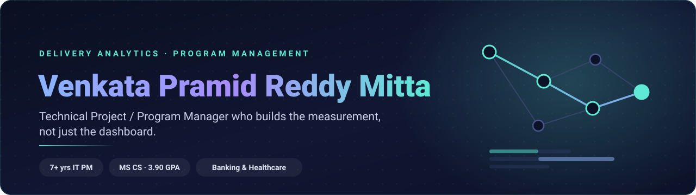

<p align="center">
  
</p>

<p align="center">
  
  
  
  
  
</p>

<!-- Stat cards: every number here is a resume fact, not a repository metric. -->
<table align="center" width="100%">
  <tr align="center">
    <td><strong>&#128197; 7+</strong><br><sub>YEARS IN IT PM</sub></td>
    <td><strong>&#127891; 3.90</strong><br><sub>MS CS GPA (/4.00)</sub></td>
    <td><strong>&#127974; 2</strong><br><sub>INDUSTRIES</sub></td>
    <td><strong>&#128101; 25+</strong><br><sub>LARGEST TEAM LED</sub></td>
    <td><strong>&#128181; $2.5M</strong><br><sub>PROGRAM BUDGET</sub></td>
  </tr>
</table>

> I run delivery, and I build the measurement underneath it. The job of a program is not to report a single confident number; it is to know, early and honestly, when that number is wrong. I lead banking and healthcare programs the ordinary way (sprints, RAID logs, budgets, release gates) and then build the small, quantitative tools that catch what a tidy status report structurally cannot.

<br>

## The arc

```
  Wipro, India                      Accenture, USA                   Rutgers University
  Associate PM                      IT Project Manager               MS, Computer Science
  Healthcare workforce mgmt         Banking cloud modernization      GPA 3.90 / 4.00
  2018  ->  2024                    Dec 2025  ->  present            Sep 2024  ->  May 2026
  offshore delivery, UAT,           $2.5M Azure program,             (in parallel with work)
  6+ releases, 30+ risks            4 workstreams, 25+ team
       |                                  |                                  |
       +----------------------------------+----------------------------------+
                                          |
                     a delivery PM leveling into a technical,
                        data-informed delivery role
```

Associate PM to IT PM, offshore healthcare delivery to a banking cloud program, with a computer science degree earned alongside the day job. The through line is the same instinct pointed at harder problems: measure the thing that is quietly going wrong before it is expensive.

<br>

## Current focus

<table width="100%">
  <tr valign="top">
    <td width="50%">
      <h3>&#128188; At work</h3>
      Leading a $2.5M Azure modernization across cloud migration, app modernization, data migration and testing. Four workstreams, a 25+ team, three vendors, and six stakeholder groups reading one set of dashboards.
    </td>
    <td width="50%">
      <h3>&#128302; In the open</h3>
      Building small, offline, deterministic analytics tools that measure what a status report cannot: when a committed date is really a coin flip, when a green rollup is red underneath, when an on-budget program is already behind schedule.
    </td>
  </tr>
</table>

<br>

## How deep, honestly

Levels answer one question: could I debug this in production at 3am, or have I only shipped with it?

| Area | Depth | Where it comes from |
|------|-------|---------------------|
| Agile, Scrum, SDLC, sprint planning, UAT, release management | `████████░░` Expert | 7+ years of ceremonies and sign-offs across banking and healthcare |
| RAID, risk, change, WBS and RACI governance | `████████░░` Expert | RAID logs, 40+ issues resolved, high-priority blockers cut 15 to 12 |
| Jira, Azure DevOps, ServiceNow, MS Project | `███████░░░` Strong | backlog, defects and change requests, 15+ milestones across two roles |
| Budget forecasting and tracking | `███████░░░` Strong | a $2.5M program held within 5% of budget across three vendors |
| Power BI, Excel | `██████░░░░` Working | stakeholder dashboards; now building the analytics beneath them |
| Python (pandas, numpy) | `█████░░░░░` Working | the measurement tools behind the dashboards, via an MS in Computer Science |
| Microsoft Azure (cloud modernization) | `██████░░░░` Working | led a $2.5M Azure modernization across four workstreams |
| Git and GitHub | `██████░░░░` Working | version control and CI for the analytics tooling |

<br>

## Building blocks
<div align="center">
  
**Delivery and Agile**
<p>
  
  
  
  
  
  
</p>

**Analytics and build**
<p>
  
  
  
  
  
  
  
</p>

**Cloud and collaboration**
<p>
  
  
  
  
  
  
</p>
</div>
<br>

## How I build

<table width="100%">
  <tr valign="top" align="center">
    <td width="33%">
      <h4>&#128073; The uncomfortable number leads</h4>
      <sub>Every tool opens with what it cannot do, or the case where it loses. A first screen full of green is marketing, not measurement.</sub>
    </td>
    <td width="33%">
      <h4>&#129518; Numbers are machine-checked</h4>
      <sub>Every figure in a document is produced by code that ran, and a checker fails the build if the prose and the measurement disagree.</sub>
    </td>
    <td width="33%">
      <h4>&#128268; Offline and reproducible</h4>
      <sub>No keys, no network at runtime. A seeded fixture, so any reviewer reproduces every number with one command.</sub>
    </td>
  </tr>
</table>

<br>

## Education

<p align="center">
  
  
  
 
</p>

<br>

## Quick connect

<p align="center">
  <a href="mailto:pramidvenkatareddy@mycvcareer.com"></a>
  <a href="https://www.linkedin.com/in/mittavenkatapramidreddy"></a>
 
</p>

<p align="center"><sub>Based in UNITED STATES. Open to IT Project Manager and Technical Program Manager roles.</sub></p>
